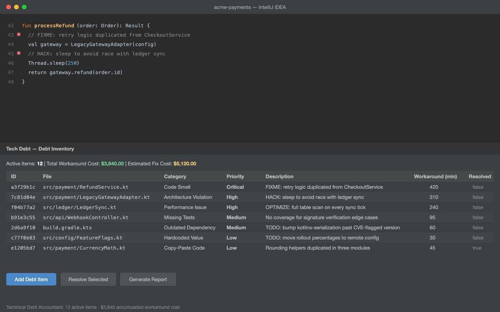
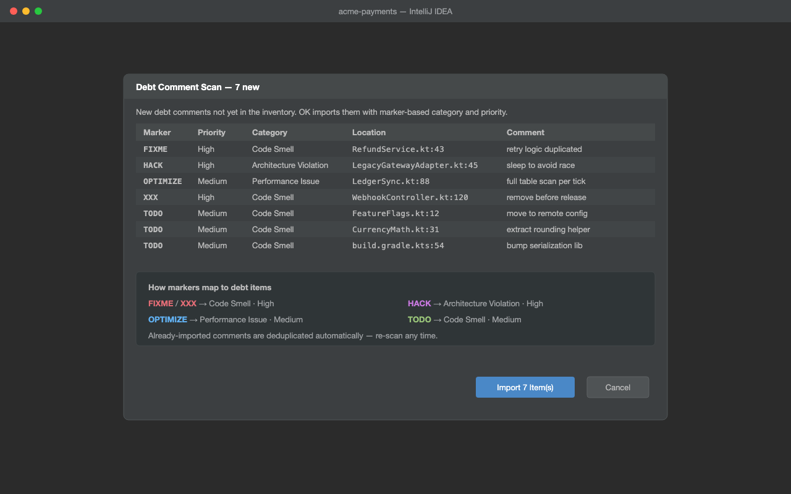
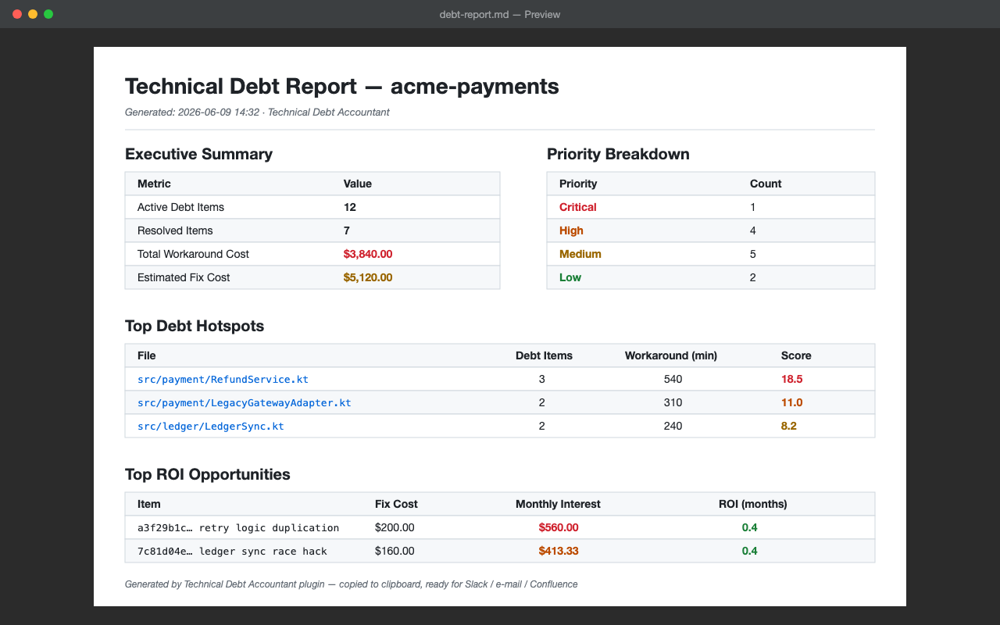
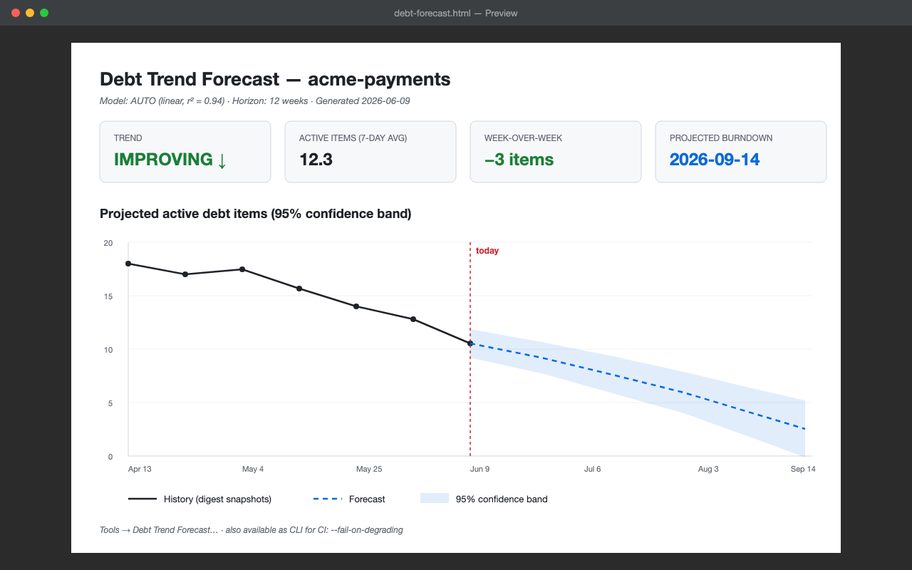
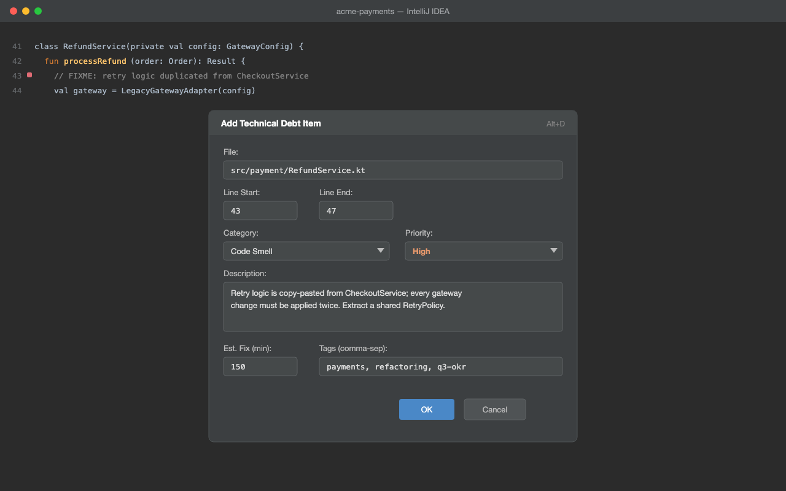
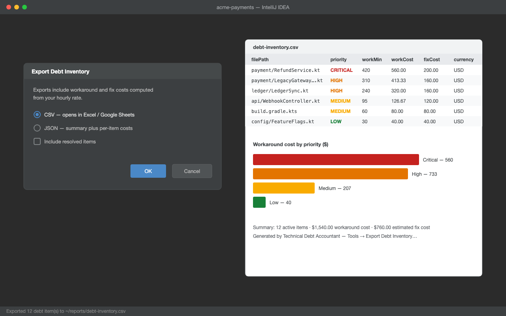

# Technical Debt Accountant

[](https://github.com/JirakJ/technical-debt-accountant/actions/workflows/build.yml)
[](https://github.com/JirakJ/technical-debt-accountant/releases)
[](LICENSE)

> Quantify your technical debt in dollars, track workaround costs, and prioritize refactoring by ROI — all inside your JetBrains IDE.

## 📸 Screenshots

| Debt Inventory | TODO/FIXME Scanner |
|---|---|
|  |  |

| Management Report | Trend Forecast |
|---|---|
|  |  |

| Add Debt at Cursor | CSV/JSON Export |
|---|---|
|  |  |

## ✨ Features

- **TODO/FIXME scanner** — `Tools → Scan TODO/FIXME Comments…` imports `TODO` / `FIXME` / `HACK` / `XXX` / `OPTIMIZE` comments as debt items with marker-based category and priority, deduplicated on re-scan; also available as a CLI (`DebtScanCli`) with `--fail-over=<n>` for CI gates
- **CSV/JSON export** — `Tools → Export Debt Inventory…` exports the backlog with computed workaround and fix costs for Excel / Google Sheets or downstream tooling

- **Debt inventory** — catalog tech debt items with category, priority, description, and estimated fix time
- **Add debt at cursor** — press **Alt+D** to log a debt item at the current file and line
- **9 debt categories** — Code Smell, Missing Tests, Outdated Dependency, Security Vulnerability, Performance Issue, Documentation Gap, Architecture Violation, Hardcoded Value, Copy-Paste Code
- **4 priority levels** — Critical (4×), High (3×), Medium (2×), Low (1×) with weight multipliers
- **Workaround timer** — start/stop timer or manually log workaround minutes with notes
- **Hotspot detection** — identifies files with the most debt by weighted score
- **Git integration** — links debt items to commits and tracks file authors
- **Gutter icons** — priority-colored markers in the editor with debt tooltips
- **Tech Debt tool window** — table view with active count, category, priority, and workaround minutes
- **Project-level persistence** — data stored in `.tech-debt/inventory.json` (Git-trackable)
- **Dollar valuation** — converts workaround time to cost using configurable hourly rate
- **Monthly interest calculation** — tracks recurring workaround costs over 30-day windows
- **ROI calculator** — calculates breakeven months (fix cost ÷ monthly interest) and prioritizes by ROI
- **Burndown chart** — tracks debt resolution trends (IMPROVING / STABLE / WORSENING)
- **Management export** — generates Markdown reports with executive summary, hotspots, and ROI opportunities
- **CSV export** — export burndown data for external analysis
- **Team aggregation** — aggregate debt metrics across team members and projects
- **JIRA integration** — link debt items to JIRA tickets
- **Trend analytics** — long-term debt trend analysis across the organization

## 🧮 Sprint Planning Recommender

Turn your debt backlog into a ready-to-copy sprint plan.

**Tools → Suggest Sprint Items…** opens a dialog where you enter:

- **Budget (hours)** — how much refactoring capacity the sprint has
- **Minimum priority** — filter out items below `LOW` / `MEDIUM` / `HIGH` / `CRITICAL`
- **Include tags** / **Exclude tags** — comma-separated tag filters
- **Allow overflow** — optionally accept one oversize item up to +20% of the budget

The recommender scores every eligible (unresolved, effort > 0) item by
`ROI = monthly interest saved ($) ÷ fix effort (hours)` using the configured `DollarValuator`, then
greedily fills the budget. Ties are broken deterministically by priority weight, then age (older
first), then id.

The result dialog shows a `JBTable` of selected items plus totals (selected hours, monthly savings,
item count, declined count). **Copy Markdown** and **Export .md** produce a Jira/GitHub-friendly
document with a summary table, selected items table, and a collapsed *Declined items* section
(each declined item carries a reason: `BUDGET`, `FILTERED`, or `NO_EFFORT`).

## 🚦 Debt SLA Policy Engine

Turn the passive debt inventory into a policy-governed backlog. Define SLAs per priority; the
engine flags items at risk / breached, auto-escalates breached items where configured, and produces
a weekly-digest Markdown with a 🟢/🟡/🔴 banner.

- `Tools → Evaluate Debt SLAs…` — runs in the background, shows breached / approaching /
  escalation tabs, and can apply priority escalations in one click.
- `Tools → Edit Debt SLA Policy` — opens `.debt-sla.json` (created from defaults if missing).

Default policy (editable as JSON):

```json
{
  "rules": [
    { "priority": "CRITICAL", "maxAgeDays": 7,   "warnAtPercent": 80 },
    { "priority": "HIGH",     "maxAgeDays": 30,  "warnAtPercent": 80,
      "escalateOnBreach": true, "escalatedPriority": "CRITICAL" },
    { "priority": "MEDIUM",   "maxAgeDays": 90,  "warnAtPercent": 80 },
    { "priority": "LOW",      "maxAgeDays": 365, "warnAtPercent": 90 }
  ],
  "defaultRule": { "priority": "LOW", "maxAgeDays": 365, "warnAtPercent": 90 }
}
```

### CI usage

The `SlaCli` entry point exits `2` on breach, which lets you fail a build on SLA violations:

```bash
java -cp technical-debt-accountant.jar \
  com.jakubjirak.debtaccountant.sla.SlaCli \
  --inventory=.tech-debt/inventory.json \
  --policy=.debt-sla.json \
  --output=md \
  --fail-on-breach > sla-report.md
```

Exit codes: `0` OK, `1` bad arguments / invalid policy, `2` breaches ≥ 1 when `--fail-on-breach`.

## 📰 Weekly Digest Report

Produce an email-ready weekly status update in one click.

**Tools → Weekly Digest…** generates a Markdown or HTML report with:

- **Summary** — active item count, total estimated cost, new and resolved in period
- **Priority Breakdown** — counts per Critical / High / Medium / Low
- **SLA Compliance** — OK / Approaching / Breached from the real `SlaEvaluator`
- **Top Hotspots** — top 5 files by cost, with item count and highest priority
- **Sprint Recommendations** — top 5 ROI items using the `SprintPlanningService` / `DollarValuator` wiring
- **Week-over-Week Delta** — count, dollar and priority-mix deltas when a previous snapshot is supplied

The HTML renderer is self-contained (inline styles, no external fonts or scripts) and includes a
`prefers-color-scheme: dark` block so it renders cleanly on light and dark mail clients. Snapshots
are stored as JSON via `DigestSnapshotStore` with atomic writes.

### CI usage

```bash
# Generate a weekly Markdown digest and save a snapshot for next week's delta
java -cp technical-debt-accountant.jar \
  com.jakubjirak.debtaccountant.digest.WeeklyDigestCli \
  --period=last7 \
  --format=md \
  --inventory=.tech-debt/inventory.json \
  --previous-snapshot=.tech-debt/snapshots/previous.json \
  --save-snapshot=.tech-debt/snapshots/$(date +%Y-%m-%d).json \
  --out=weekly-digest.md \
  --project="My Service" \
  --hourly-rate=95

# HTML digest for a specific ISO week (2026-W16)
java -cp technical-debt-accountant.jar \
  com.jakubjirak.debtaccountant.digest.WeeklyDigestCli \
  --period=week:2026-W16 \
  --format=html \
  --inventory=.tech-debt/inventory.json \
  --out=weekly-digest.html
```

Exit codes: `0` OK, `1` argument or I/O error.

## 📈 Debt Trend Forecasting

Project where the backlog is heading before the next retro.

**Tools → Debt Trend Forecast…** (or the `DebtForecastCli` command-line entry point)
reads the JSON snapshots produced by the Weekly Digest feature and fits both a
linear and an exponential model to the chronological series, then projects the
next *N* weeks with a 95% confidence band.

The forecast answers three executive-level questions:

1. **Is the team paying debt down or adding more?** — reported as
   `IMPROVING` / `FLAT` / `DEGRADING` based on slope.
2. **When does the backlog reach zero?** — a concrete date, or `never`
   if the slope is flat or positive.
3. **What will the backlog look like in 12 weeks?** — a per-week table of
   predicted count, predicted dollars, and a 95% CI (`±1.96 × residual std. error`).

### Methodology

- **Linear model:** Ordinary Least Squares fit `count = slope × week + intercept`.
- **Exponential model:** log-linear fit `count = a × exp(b × week)` — points
  with non-positive `y` are dropped before the log transform.
- **AUTO:** fits both and picks the higher r² (linear wins ties).
- **Confidence interval:** `±1.96 × sqrt(SSE / (n − 2))` around the linear fit.
- **Same-day deduplication:** if multiple snapshots fall on the same UTC date,
  only the one with the latest `takenAtMillis` is kept.
- **Resolved items are excluded** — the forecast targets *open* debt only.

> _Screenshot placeholder — add `docs/forecast-chart.png` once the feature ships
> in a release build._

### CLI usage

```bash
# 12-week Markdown forecast, auto-selected model
java -cp technical-debt-accountant.jar \
  com.jakubjirak.debtaccountant.forecast.DebtForecastCli \
  --snapshots-dir=.tech-debt/snapshots \
  --horizon-weeks=12 \
  --model=auto \
  --format=md \
  --out=debt-forecast.md

# Self-contained HTML forecast with inline SVG chart
java -cp technical-debt-accountant.jar \
  com.jakubjirak.debtaccountant.forecast.DebtForecastCli \
  --snapshots-dir=.tech-debt/snapshots \
  --format=html \
  --out=debt-forecast.html
```

### CI guard — `--fail-on-degrading`

Add a job step that makes the pipeline fail when the team is accumulating
technical debt faster than it is being resolved:

```yaml
- name: Technical debt forecast
  run: |
    java -cp technical-debt-accountant.jar \
      com.jakubjirak.debtaccountant.forecast.DebtForecastCli \
      --snapshots-dir=.tech-debt/snapshots \
      --horizon-weeks=12 \
      --format=md \
      --out=debt-forecast.md \
      --fail-on-degrading
- uses: actions/upload-artifact@v4
  with:
    name: debt-forecast
    path: debt-forecast.md
```

Exit codes: `0` OK, `1` argument/I/O error, or `DEGRADING` trend detected
when `--fail-on-degrading` is set. The output file is written in both cases.

## 📦 Installation

### From JetBrains Marketplace
1. Open **Settings** → **Plugins** → **Marketplace**
2. Search for **Technical Debt Accountant**
3. Click **Install** and restart the IDE

### From ZIP
1. Download the latest release from [Releases](https://github.com/JirakJ/technical-debt-accountant/releases)
2. Open **Settings** → **Plugins** → ⚙️ → **Install Plugin from Disk…**
3. Select the downloaded ZIP file and restart the IDE

## 🚀 Quick Start

1. Open a project in your JetBrains IDE
2. Place your cursor on a line with technical debt
3. Press **Alt+D** (or **Tools** → **Add Debt Item**) to log the debt
4. Fill in the category, priority, description, and estimated fix time
5. Open the **Tech Debt** tool window (bottom panel) to view your inventory
6. Use **Tools** → **Log Workaround Time** to track time spent on workarounds
7. Use **Tools** → **Generate Debt Report** to create an executive summary

## ⚙️ Configuration

Open **Settings** → **Tools** → **Technical Debt Accountant** to configure:

| Setting | Default | Description |
|---------|---------|-------------|
| Hourly Rate | `80.0` | Developer hourly rate for dollar valuation |
| Currency | `USD` | Currency for cost display (USD, EUR, GBP, CZK) |
| Inventory Path | `.tech-debt` | Directory for debt inventory storage (relative to project root) |
| Show Gutter Icons | `true` | Display priority-colored icons in the editor gutter |

## 🎯 Usage

### Adding Debt Items

Press **Alt+D** anywhere in the editor to open the Add Debt dialog:

- **File Path** — auto-filled from the current editor file
- **Line Start / End** — auto-filled from cursor position
- **Category** — select from 9 categories (Code Smell, Missing Tests, Security Vulnerability, etc.)
- **Priority** — Critical, High, Medium, or Low
- **Description** — free-text description of the debt
- **Estimated Fix (minutes)** — how long you estimate the fix would take (default: 60)
- **Tags** — comma-separated labels for organization

### Tracking Workaround Time

Use **Tools** → **Log Workaround Time** to record time spent working around debt:

- Select an active debt item from the list
- Enter the number of minutes spent
- Optionally add a note describing the workaround

Alternatively, use the timer mode: `WorkaroundTracker.startTimer()` → `stopTimer()` to track time automatically.

### Generating Reports

Use **Tools** → **Generate Debt Report** to create a Markdown report containing:

- **Executive summary** — total items, active vs. resolved, total workaround cost
- **Priority breakdown** — items and costs grouped by CRITICAL / HIGH / MEDIUM / LOW
- **Category breakdown** — items grouped by debt category
- **Top 5 hotspots** — files with the highest weighted debt score
- **Top 5 ROI opportunities** — items with the fastest payback period

The report is copied to your clipboard for pasting into docs, Slack, or email.

### Hotspot Detection

Hotspots are files with the most concentrated debt. The score is calculated as:

```
score = (priority.weight × 10) + (workaroundMinutes × 0.5)
```

Only active (unresolved) items are counted. View the top 10 hotspots in the Tech Debt tool window.

### Dollar Valuation

Each debt item's cost is calculated from tracked workaround time:

| Metric | Formula |
|--------|---------|
| Workaround Cost | `totalWorkaroundMinutes × (hourlyRate ÷ 60)` |
| Estimated Fix Cost | `estimatedFixMinutes × (hourlyRate ÷ 60)` |
| Monthly Interest | `last30DaysWorkaroundMinutes × (hourlyRate ÷ 60)` |
| ROI (Breakeven) | `estimatedFixCost ÷ monthlyInterest` months |

## 🔌 Keyboard Shortcuts

| Shortcut | Action | Description |
|----------|--------|-------------|
| **Alt+D** | Add Debt Item | Log a new tech debt item at the current cursor position |

## 📋 Requirements

- IntelliJ IDEA 2025.1+ (build 251+)
- Git4Idea plugin (optional — for Git integration features)
- Java 17+

## 🏗️ Building from Source

```bash
git clone https://github.com/JirakJ/technical-debt-accountant.git
cd technical-debt-accountant
./gradlew build
```

The built plugin ZIP will be in `build/distributions/`.

## 📝 License

MIT — [LICENSE](LICENSE)

## 👤 Author

**Jakub Jirák** — [@JirakJ](https://github.com/JirakJ)
